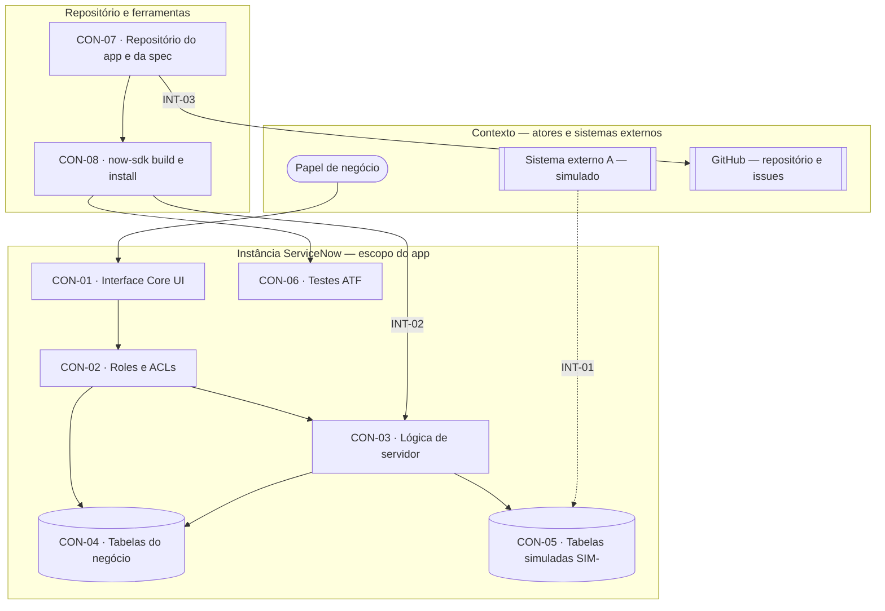

<!--
  hld.md — desenho de alto nível (High-Level Design) do produto TO-BE.

  GRAMÁTICA ESTRITA — este arquivo é validado por `python3 ../tools/check-hld.py` (caminho
  relativo ao SKILL.md que invoca; ver ../tools/references/paths.md).
  - O cabeçalho traz duas linhas que o validador lê: `Modo:` (completo | compacto) e
    `Contexto:` (greenfield | brownfield). Sem elas o validador assume completo/greenfield.
  - Seções obrigatórias em QUALQUER modo: `## Contexto e containers`, `## Decomposição por
    módulo`, `## Integrações externas`, `## Táticas por RNF`, `## Decisões de arquitetura (ADR)`.
    No modo completo também são obrigatórias: `## Fluxos arquiteturais`, `## Topologia de
    implantação`, `## Segurança de alto nível`, `## Riscos técnicos e spikes`.
    `## Delta AS-IS → TO-BE` é opcional na gramática e cobrado por AVISO no brownfield.
  - Cada seção tem UMA tabela de colunas fixas (não renomear, não reordenar, não adicionar nem
    remover colunas). Prosa e diagramas entre as seções são permitidos e ignorados pelo parser.
  - IDs: CON-01 / INT-01 / FLA-01 / TRB-01 / ADR-01 / RSK-01 (dois dígitos, únicos por seção).
  - Célula sem valor NUNCA fica vazia: usar `—`.
  - AS TABELAS SÃO A FONTE DE VERDADE. O diagrama Mermaid é ilustração: quem consome este
    arquivo (relatório consolidado, outras skills) usa `check-hld.py --json`, que lê as tabelas.
    Todo `CON-NN` citado em qualquer lugar do arquivo — inclusive no diagrama — precisa existir
    no inventário de containers, senão o validador falha.
  - Mermaid: usar `flowchart` com `subgraph` (mesmo estilo do `architecture.md` AS-IS). NÃO usar
    `C4Context` — a sintaxe é experimental e não renderiza de forma estável.

  ALVO SERVICENOW (fork Speckit ServiceNow, item 31 do design):
  - O produto é um app escopado dentro de uma instância ServiceNow. O escopo (`x_<código>_<app>`)
    é lido de `app/now.config.json` e nunca digitado de memória.
  - Containers mínimos: a instância (PDI ou ambiente do cliente) com o escopo do app — interface
    Core UI, roles e ACLs, lógica de servidor, tabelas do negócio, tabelas simuladas `SIM-` e
    testes ATF — mais o repositório GitHub (fonte da verdade e issues) e o caminho de instalação
    (`now-sdk` via `npm run reinstall`). Container é peça implantável ou configurável da
    plataforma, não camada interna de código.
  - ADR-01 é sempre «configurar × customizar»: o que sai de configuração nativa (dicionário, Form,
    List, report, ACL, UI Policy, Data Policy) e o que exige script (Business Rule, Script
    Include, Flow), na ordem de escolha da `architecture.mdc`.
-->

# High-Level Design (TO-BE) — [Nome do Projeto]

Status: draft
Última atualização: YYYY-MM-DD
Versão: 1.0
Modo: completo
Contexto: greenfield
Fonte: modules.md, requirements.md, product-requirements.md, flow-map.md, context-map.md, benchmark.md, tech-rules/

<!-- id: hld-summary -->

## Resumo executivo

[Um parágrafo em linguagem de negócio: que peças o sistema novo tem, quem fala com quem e qual é
a decisão de arquitetura que mais condiciona o resto. Sem jargão sem explicação.]

---

<!-- id: hld-containers -->

## Contexto e containers

*(C4 nível 1 — Contexto: quem usa o sistema e com que sistemas externos ele fala. C4 nível 2 —
Containers: as peças executáveis/implantáveis do sistema, cada uma com um `CON-NN`. Um container é
algo que roda e pode ser implantado sozinho: uma aplicação web, uma API, um worker, um banco, uma
fila. Não é classe nem camada interna.)*



### Inventário de containers

| ID | Nome | Responsabilidade | Tecnologia |
|----|------|------------------|------------|
| CON-01 | Interface Core UI | Mostra as telas `TEL-` como form, list ou report, com menu do app, related lists, activity e UI Actions | Core UI clássica (UI16): `Form()`, `List()`, `sys_report`, UI Action e UI Policy em Fluent (`harness/servicenow-ui.md`, `architecture.mdc`) |
| CON-02 | Roles e ACLs | Decide quem lê, grava, cria e apaga cada tabela e campo | Roles `<escopo>.<papel>` e ACL de registro e de campo em Fluent (`security.mdc`) |
| CON-03 | Lógica de servidor | Aplica as regras de negócio que a configuração não resolve | Business Rule, Script Include e Flow em Glide server-side, scripts em `app/src/server/` (`conventions.mdc`) |
| CON-04 | Tabelas do negócio | Guarda os registros do produto | Tabelas `<escopo>_<sufixo>` do `data-model.json`, geradas pelo `sn-scaffold` (`architecture.mdc`) |
| CON-05 | Tabelas simuladas SIM- | Fazem o papel dos sistemas externos, com rótulo «Simulado» e interruptor de falha | Tabelas do escopo descritas em `inputs/simulacoes.md` (`architecture.mdc`) |
| CON-06 | Testes ATF | Provam cada regra com caso positivo e negativo; a suíte de regressão roda a cada reinstalação | `Test()` e `TestSuite()` em Fluent, executados por `npm run atf` (`test-strategy.mdc`) |
| CON-07 | Repositório do app e da spec | Guarda a fonte da verdade: app Fluent em `app/`, spec em `outputs/spec/`, prints e backlog em issues | GitHub privado (`deploy-and-build.mdc`) |
| CON-08 | now-sdk build e install | Transforma o Fluent em metadados e instala na instância, de forma idempotente | `@servicenow/sdk` via `npm run reinstall` (`deploy-and-build.mdc`) |

---

<!-- id: hld-decomposition -->

## Decomposição por módulo

*(Uma linha por módulo `MOD-XXX` do `modules.md`. Container = `CON-NN` do inventário acima, ou
`N/A` quando o módulo não vira software nesta entrega — nesse caso a coluna «Papel no módulo»
precisa dizer por quê. Módulo servido por mais de um container: uma linha por container.)*

| Módulo | Container | Papel no módulo |
|--------|-----------|-----------------|
| MOD-EXEMPLO-A | CON-04 | Tabelas do cadastro |
| MOD-EXEMPLO-A | CON-03 | Business Rule que recusa cadastro duplicado |
| MOD-EXEMPLO-A | CON-01 | Telas de cadastro e consulta (TEL-001, TEL-002) |
| MOD-EXEMPLO-B | N/A | Fora desta entrega — o processo continua manual na onda 1 (decisão de rollout) |

---

<!-- id: hld-integrations -->

## Integrações externas

*(Uma linha por sistema externo do `context-map.md` (seção «Sistemas, integrações, contratos
mencionados») e do `architecture.md` quando há legado. Direção = `entrada` (o externo chama o
sistema), `saída` (o sistema chama o externo) ou `bidirecional`. Estilo = `síncrono` (a resposta
é esperada na hora) ou `assíncrono` (mensagem/fila/arquivo, resposta depois). Falha = o que
acontece quando o sistema externo não responde.)*

| ID | Sistema externo | Container | Direção | Estilo | Protocolo | Falha |
|----|-----------------|-----------|---------|--------|-----------|-------|
| INT-01 | [Sistema externo A] | CON-05, CON-03 | entrada | assíncrono | Tabela simulada `SIM-01` (ver `inputs/simulacoes.md`); contrato real em aberto | Interruptor de falha ligado: o Script Include da integração registra a falha e o processo segue |
| INT-02 | Instância ServiceNow (PDI) | CON-08 | saída | síncrono | `now-sdk build --frozenKeys` + `now-sdk install` via `npm run reinstall` | Prefixo de escopo diferente do `app/now.config.json` para antes de instalar; install falho fica no sync-log |
| INT-03 | GitHub (repositório e issues) | CON-07 | saída | síncrono | `gh` + API REST (issues, sub-issues, permalink de PNG) | Publicador para com erro; reexecução não duplica issue (`id-map.json`) |

---

<!-- id: hld-flows -->

## Fluxos arquiteturais

*(Só os fluxos que a arquitetura precisa sustentar — os de maior volume, maior risco ou que
cruzam sistemas. Fluxo = `FLX-xxx` do `flow-map.md`, ou `—` quando o fluxo é puramente técnico e
não aparece lá. Caminho = a sequência de containers e integrações, na ordem em que a informação
passa.)*

| ID | Fluxo | Caminho | Nota |
|----|-------|---------|------|
| FLA-01 | FLX-001 | CON-01 → CON-02 → CON-03 → CON-04 | Caminho de escrita mais frequente: a ACL libera, a Business Rule confere a regra e grava |
| FLA-02 | FLX-002 | CON-03 → CON-05 → INT-01 → CON-04 | Depende do sistema externo A simulado; ver a linha de falha em `## Integrações externas` |
| FLA-03 | — | CON-07 → CON-08 → INT-02 → CON-06 | Reinstalação: build, install, contagem do seed e suíte ATF de regressão |

---

<!-- id: hld-deployment -->

## Topologia de implantação

*(Onde cada container roda, em cada ambiente que o projeto mantém. Quando a decisão ainda não
existe, escrever a alternativa em avaliação e abrir uma linha em «Questões em aberto» — nunca
inventar um ambiente.)*

| Ambiente | Topologia | Observação |
|----------|-----------|------------|
| Desenvolvimento | [ex.: uma PDI com o escopo do app; repositório local do FDE com `app/`] | A PDI é reclamada depois de dias sem uso e volta com `npm run reinstall` |
| Homologação | [ex.: instância de teste do cliente, ou segunda PDI com o mesmo prefixo] | Mesmo comando de reinstalação e mesma semente do seed |
| Produção | [ex.: dev → test → prod pelo Application Repository, nunca por update set (RN-SN-164, RN-SN-167)] | [integrações reais substituem as tabelas SIM-] |

---

<!-- id: hld-nfr-tactics -->

## Táticas por RNF

*(Uma linha por requisito não funcional com métrica (`RNF-...` do `requirements.md`). Para cada
um: a tática de arquitetura que o sustenta OU o registro explícito de que o risco foi aceito.
«Risco aceito» é resposta válida — omitir o RNF não é. Containers = onde a tática mora.)*

| RNF | Métrica | Tática ou risco aceito | Containers | Justificativa |
|-----|---------|------------------------|------------|---------------|
| RNF-DESEMPENHO-001 | [ex.: list e form carregam em até 3 s com o volume do seed] | [ex.: GlideAggregate para contar, sem consulta em laço, ACL sem GlideRecord (RN-SN-20, RN-SN-22, RN-SN-142)] | CON-01, CON-03 | Volume previsto no Plan |
| RNF-SEGURANCA-001 | [ex.: 100% das ações relevantes com autor e hora] | [ex.: `audit` e journal nas tabelas com form] | CON-02, CON-04 | Exigência de compliance do cliente |
| RNF-DISPONIBILIDADE-001 | [ex.: 99,5% no horário comercial] | Risco aceito — a disponibilidade é a da instância contratada | CON-01 | O app não controla a infraestrutura da plataforma |

---

<!-- id: hld-security -->

## Segurança de alto nível

*(Fronteiras de confiança: onde o dado atravessa uma linha em que a origem deixa de ser
confiável — internet → sistema, sistema → sistema externo, usuário comum → área administrativa.
Em brownfield, amarrar cada fronteira às ameaças `THR-xxx` do `threat-model.md` do AS-IS que ela
fecha ou herda. Sem legado, usar `—` na última coluna.)*

| ID | Fronteira | Containers | Controles | Ameaça AS-IS |
|----|-----------|------------|-----------|--------------|
| TRB-01 | Usuário no navegador → instância | CON-01, CON-02 | [ex.: login da plataforma, roles do app, ACL por tabela, campo e operação; UI Policy só como UX] | THR-001 |
| TRB-02 | Outro escopo ou API → escopo do app | CON-02, CON-03 | [ex.: nenhum `CrossScopePrivilege` não declarado; Script Include `package_private`; Web Service Access desligado] | — |
| TRB-03 | Repositório e ferramentas → instância | CON-07, CON-08 | [ex.: credencial só em `.env.instancia`, fora do git e negada ao agente; prefixo conferido antes do install] | — |

---

<!-- id: hld-adr -->

## Decisões de arquitetura (ADR)

*(Uma linha por decisão macro — as que já nasceram no kickoff da `spec-tech-rules` (Fase 6.5) e
as que nasceram aqui. Esta skill NÃO redecide a stack: registra a decisão que já está na rule,
com o que foi descartado e o preço que a escolha cobra. Origem = arquivo de rule que carrega a
decisão (ex.: `architecture.mdc`), ou `—` quando a decisão nasceu no próprio HLD.
**ADR-01 é sempre «configurar × customizar»** (validador `ADR_CONFIGURE_VS_CUSTOMIZE` da skill):
diz o que sai de configuração nativa, o que exige script e o preço de cada script.)*

| ID | Decisão | Contexto | Alternativas rejeitadas | Consequências | Origem |
|----|---------|----------|-------------------------|---------------|--------|
| ADR-01 | Configurar × customizar: tabela, Form, List, report, menu, role, ACL, UI Policy e Data Policy saem de configuração nativa ou do `sn-scaffold`; script (Business Rule, Script Include, Flow) só para [regras que a configuração não resolve] | Plataforma com recurso nativo para quase toda tela; o app precisa ser regerável e sobreviver a upgrade (RN-SN-13, RN-SN-60, RN-SN-151) | Customizar a interface (UI Builder, Service Portal, página Jelly) ou pôr regra em Client Script — custo de manutenção e risco no upgrade | Tela que a Core UI não faz vira form, list ou report simples e GAP; cada script novo exige teste ATF positivo e negativo | architecture.mdc |
| ADR-02 | [ex.: integrações externas simuladas como tabelas `SIM-` do app] | [os sistemas externos não têm contrato nem acesso nesta fase] | [mock fora da instância ou integração real] | [trocar pela integração real muda só o Script Include da integração (RN-SN-162)] | architecture.mdc |
| ADR-03 | [ex.: instalação só por `npm run reinstall`, com o git como fonte da verdade] | [instância de desenvolvedor é volátil] | [update set ou mudança direta na instância] | [toda mudança feita na instância precisa voltar para o `.now.ts`] | deploy-and-build.mdc |

---

<!-- id: hld-risks -->

## Riscos técnicos e spikes

*(O que ainda pode derrubar o desenho e o que fazer para descobrir cedo. Cada spike vira
candidato a task do tipo Spike na Fase 8 (`spec-tasks`) — escrever o spike como pergunta com
resposta verificável, não como «estudar X».)*

| ID | Risco | Impacto | Spike sugerido | Alvo |
|----|-------|---------|----------------|------|
| RSK-01 | [ex.: script de ACL roda por linha em list e report e pode ficar lento (RN-SN-142)] | [list acima do tempo do RNF] | [medir a list com o volume do seed e dois usuários do papel] | CON-02 |
| RSK-02 | [ex.: plugin ou licença exigida pelo desenho não está na instância do cliente] | [recurso indisponível em produção] | [listar plugins e papéis licenciados da instância-alvo e conferir contra o desenho] | CON-03 |
| RSK-03 | [ex.: contrato real do sistema externo A muda a tabela simulada] | [retrabalho no módulo] | [revisar a tabela SIM- quando o GAP do contrato fechar] | INT-01 |

---

<!-- id: hld-delta -->

## Delta AS-IS → TO-BE

*(Só em brownfield — remover a seção inteira em greenfield. Uma linha por componente do
`architecture.md` (inventário de componentes do AS-IS). Tipo = `mantém` (segue como está),
`substitui` (o TO-BE toma o lugar), `absorve` (a função vira parte de um container novo),
`aposenta` (deixa de existir sem substituto) ou `novo` (não existia no AS-IS).)*

| Componente AS-IS | Destino TO-BE | Tipo | Nota |
|------------------|---------------|------|------|
| [Componente legado X] | CON-02 | absorve | [as regras saem do legado e passam a viver na API nova] |
| [Componente legado Y] | — | aposenta | [processo deixa de existir com a nova esteira] |

---

<!-- id: open-questions -->

## Questões em aberto

*(Lacunas do desenho que ainda dependem de decisão. Ver `../tools/references/task-pipeline.md`
§2.16: esta skill **não cria** `GAP-XXX` — quem converte estas linhas em GAP é o `spec-iterate`.)*

| # | Pergunta | Evidência/contexto (RNF, INT-NN, arquivo:linha) | Bloqueia próxima fase? |
|---|----------|--------------------------------------------------|-------------------------|
| 1 | | | |

---

<!-- id: hld-coverage -->

## Cobertura

*(Seção NÃO parseada pelo validador. Após rodar `python3 ../tools/check-hld.py outputs/spec/hld.md`
com exit 0, colar aqui o bloco MÉTRICAS impresso e tratar ou justificar cada aviso.)*

```
[colar aqui a saída MÉTRICAS do check-hld.py]
```
