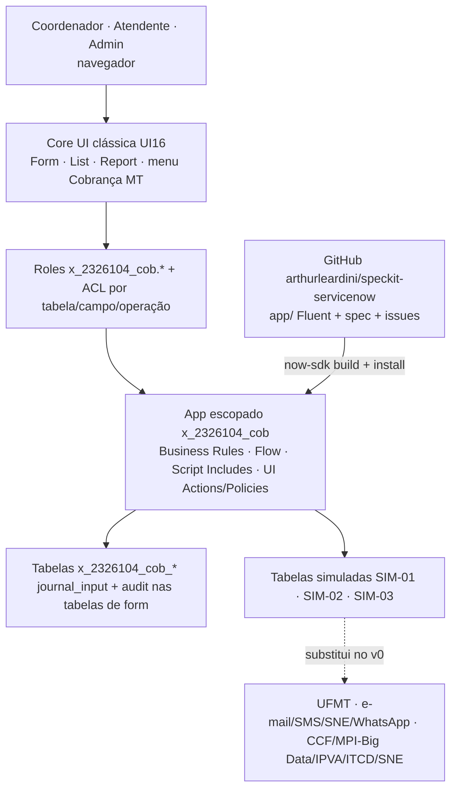

# Especificação Técnica — Cobrança MT (2.6 Cobrança, SEFAZ-MT)

> **Fase:** Explore · **Versão:** 0.1 · **Status:** preliminar
> **Documentos irmãos:** [HLD](./hld-funcional.md) · [Funcional](./especificacao-funcional.md) · [Modelo de Dados](./modelo-de-dados.md) · [GAPs](./gaps.md)
>
> Decisões de arquitetura do kit: `docs/designs/speckit-servicenow-v0.md` (A1–A10). Integrações simuladas: `inputs/simulacoes.md`.

## Changelog
| Versão | Data | Mudança |
|---|---|---|
| 0.1 | 2026-11-24 | versão inicial |

## 1. Visão em camadas

## 2. Componentes de infraestrutura

| Componente | Tecnologia | Papel |
|---|---|---|
| Instância | ServiceNow PDI `dev493801`, release Brazil | Hospeda o app; é o protótipo desde o Explore |
| App | Aplicação escopada `x_2326104_cob` ("Cobrança MT"), escopo lido de `app/now.config.json` | Tabelas, forms, lists, reports, menu, roles, ACLs, regras e testes |
| Código-fonte do app | Fluent / ServiceNow SDK `@servicenow/sdk` 4.14.3 (`app/package.json`), `@servicenow/glide` 27.0.5 | Metadados em `app/src/fluent/**`, scripts de servidor em `app/src/server/**`; `$id` fixos em `keys.ts` |
| Interface | Core UI clássica (UI16): `Form()` em seções de 1–2 colunas, `List()`, related lists, formatter de activity, UI Action, UI Policy, report simples | Todas as telas `TEL-`; sem Workspace, Service Portal ou UI Builder |
| Segurança | Roles `x_2326104_cob.coordenador`, `.atendente`, `.admin`; ACL de leitura por role e ACL de linha "própria carteira" do atendente | Matriz §1.2 da especificação funcional |
| Testes | ATF (`Test()`, suíte `cob-regressao`) via `now-sdk cicd test run` | Recibo por story; desfecho do teste de form conforme item 9 do design |
| Dados de demonstração | `Record()` com `installMethod: 'demo'` gerado pelo `sn-seed`; CPF/CNPJ fictícios com DV válido e `ficticio = true` | 50 registros por tabela, 1 registro demo por tela de form, 1 usuário demo por role |
| Instalação | `npm run reinstall` (build `--frozenKeys` + install + contagem + suíte ATF) | Idempotente; registra a linha de install no `sync-log.md` |
| Captura de telas | Playwright + Chromium (`sn-capture`), impersonate do papel da tela, 1440×900 | `outputs/spec/screens/<TEL>.png` |
| Backlog e repositório | GitHub privado `arthurleardini/speckit-servicenow`, issues e sub-issues | Spec, app e backlog no mesmo repositório |

## 3. Integrações externas

No v0 nenhuma integração sai da instância: cada uma é tabela do app com seed fictício e rótulo "Simulado".

| Sistema | Direção | Dados trafegados | Observabilidade |
|---|---|---|---|
| Modelo de score da UFMT — **SIM-01** (`x_2326104_cob_score_sim`) | entrada | score por contribuinte e tributo, versão do modelo, data de ingestão, status | TEL-011 (cobertura por tributo), TEL-012; contagem de "sem score" no ciclo |
| Canais e-mail, SMS, SNE, WhatsApp — **SIM-02** (`x_2326104_cob_envio_sim`, `x_2326104_cob_canal_sim`) | saída | comunicação por canal e retorno de entrega; interruptor de falha por canal; opt-in exigido no WhatsApp | TEL-015, TEL-018, TEL-019; status da comunicação |
| Fontes de débito CCF, MPI/Big Data, IPVA, ITCD, SNE — **SIM-03** (`x_2326104_cob_debito_stg`, campo `origem`) | entrada | débitos por documento, tributo, valor e vencimento | TEL-001 (execução por fonte), TEL-002 (rejeições), TEL-006 |
| Sinalizações coercitivas de outras coordenadorias (CCF/SNE/SUCOM) | entrada | flag e descrição por caso | campo `sinal_coercitivo` no caso, preenchido pelo seed (GAP-016) |

## 4. Premissas técnicas

| Premissa | Detalhe | GAP relacionado |
|---|---|---|
| Nome de tabela cabe em 30 caracteres | Prefixo `x_2326104_cob_` (14) + sufixo ≤ 16; maior nome previsto `x_2326104_cob_sincronizacao` (27) | — |
| Report da Core UI disponível no app escopado | `Record({ table: 'sys_report' })` aparece na UI16; se não aparecer, TEL-011, 016, 022, 026, 027, 028 e 031 viram list com group-by | GAP-013 |
| Related list por contribuinte no dossiê | Débitos, parcelamentos e comunicações aparecem no form do caso por relacionamento definido sobre `contribuinte` | GAP-012 |
| Integrações simuladas como tabela | Score, canais e fontes viram tabelas do app (A8); contrato real fora do v0 | GAP-008, GAP-009, GAP-011 |
| Escala do score na simulação | 0 a 100 (`decimal`), só para o seed | GAP-008 |
| ACL de linha do atendente | Leitura de caso, contribuinte, interação e regularização condicionada a `atendente = usuário logado` | — |
| Volume do seed | 50 registros por tabela no Explore; até 300 no Plan (limite de 1.000 iterações do laço de Flow) | — |
