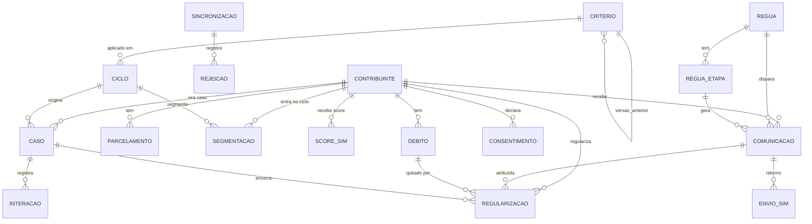

# Modelo de Dados — Cobrança MT (2.6 Cobrança, SEFAZ-MT)

> **Fase:** Explore · **Versão:** 0.1 · **Status:** preliminar
> **Documentos irmãos:** [HLD](./hld-funcional.md) · [Funcional](./especificacao-funcional.md) · [Técnica](./especificacao-tecnica.md) · [GAPs](./gaps.md)
>
> Prévia para o gerador: `outputs/spec/data-model.previa.json` (mesmo conteúdo, formato JSON). A autoridade definitiva é o `data-model.json` que a `spec-data-model` emite no Plan. Todos os registros são dados fictícios gerados pelo `sn-seed`.

## Changelog
| Versão | Data | Mudança |
|---|---|---|
| 0.1 | 2026-11-24 | versão inicial: 21 tabelas, 7 módulos |

## Convenções

- Escopo `x_2326104_cob`; tabela = `x_2326104_cob_<sufixo>`, sufixo ≤ 16 caracteres, nome total ≤ 30. Maior nome: `x_2326104_cob_sincronizacao` (27).
- Colunas das tabelas próprias sem prefixo. Tipos ServiceNow: `string`, `integer`, `decimal`, `boolean`, `reference`, `choice`, `glide_date`, `glide_date_time`, `currency`, `journal_input`.
- **journal**: tabela com form ganha a coluna `comentarios` (`journal_input`) e o formatter de activity; o seed grava 2 a 3 linhas de journal por registro demo.
- **audit**: histórico de alteração ligado na tabela.
- **simulation**: tabela de integração simulada (`SIM-`), label termina em "(Simulado)".
- **pessoa**: tabela com dado de pessoa; tem `ficticio` (boolean, obrigatória, `true` em todo registro do seed). Colunas `cpf` e `cnpj` marcadas com formato **CPF**/**CNPJ**: só documentos fictícios com DV válido, listados em `_documentos.json`.
- Usuários (atendente, coordenador, quem publicou) referenciam `sys_user`.

## 1. Entidades principais

| Entidade | Papel no sistema | Atributos principais | Usada por |
|---|---|---|---|
| `x_2326104_cob_contribuinte` | Contribuinte e visão única (pessoa) | nome, tipo_pessoa, cpf, cnpj, atendente, segmento, score, sem_score, valor_em_aberto, ficticio | RF-102, RF-105, RF-205, RF-507, RF-903 |
| `x_2326104_cob_debito` | Débito consolidado por origem | contribuinte, origem (SIM-03), tributo, valor, vencimento, dias_atraso, status, sobreposto | RF-101, RF-102, RF-103, RF-503 |
| `x_2326104_cob_parcelamento` | Parcelamento e risco de rompimento | contribuinte, parcelas_atraso, status, alerta_risco | RF-103, RF-104, RF-503 |
| `x_2326104_cob_sincronizacao` | Execução de sincronização por fonte | fonte, status, volume, rejeitados | RF-101, RF-106, RF-107 |
| `x_2326104_cob_rejeicao` | Log de rejeição | sincronizacao, fonte, motivo | RF-102 |
| `x_2326104_cob_debito_stg` | Staging das fontes (SIM-03, pessoa) | origem, cpf, cnpj, tributo, valor, processado, falha_simulada, ficticio | RF-101, RF-102 |
| `x_2326104_cob_criterio` | Versão de critério de qualificação | versao, estado, tributo, valor_minimo, atraso_minimo_dias, usar_score, threshold_score, pct_grupo_controle, versao_anterior | RF-201, RF-202, RF-205 |
| `x_2326104_cob_ciclo` | Ciclo de qualificação e efeito incremental | criterio, estado, totais por segmento, taxa_cobrada, taxa_controle, efeito_incremental | RF-203, RF-204, RF-206, RF-604 |
| `x_2326104_cob_segmentacao` | Contribuinte no ciclo (segmento e funil) | ciclo, contribuinte, criterio, segmento, sem_score, estagio_funil | RF-203, RF-204, RF-205, RF-601 |
| `x_2326104_cob_score_sim` | Score UFMT (SIM-01) | contribuinte, tributo, score, versao_modelo, status | RF-301, RF-302, RF-305, RF-306 |
| `x_2326104_cob_regua` | Régua de cobrança | carteira, ativa, janela_atribuicao_dias, ordem_fallback | RF-401, RF-404 |
| `x_2326104_cob_regua_etapa` | Etapa da régua | regua, ordem, offset_dias, canal, template, acao_sem_resposta | RF-401, RF-403, RF-409 |
| `x_2326104_cob_comunicacao` | Comunicação disparada | contribuinte, regua, etapa, canal, status, tentativas | RF-402, RF-403, RF-406, RF-408 |
| `x_2326104_cob_envio_sim` | Retorno do canal (SIM-02) | comunicacao, canal, status_retorno | RF-406 |
| `x_2326104_cob_canal_sim` | Canal e interruptor de falha (SIM-02) | canal, contratado, forcar_falha, exige_opt_in | RF-404, RF-405 |
| `x_2326104_cob_consentimento` | Opt-in/opt-out por canal | contribuinte, canal, situacao | RF-405 |
| `x_2326104_cob_regularizacao` | Regularização e origem | contribuinte, debito, ciclo, tributo, valor, origem, canal, instrumento, grupo_controle, caso, atendente | RF-407, RF-506, RF-602, RF-603, RF-904 |
| `x_2326104_cob_caso` | Caso da cobrança qualificada (dossiê) | contribuinte, atendente, estagio, prioridade, score, sinal_coercitivo | RF-501 a RF-507 |
| `x_2326104_cob_interacao` | Interação do atendente | caso, atendente, tipo, resultado, descricao | RF-505 |
| `x_2326104_cob_meta` | Meta de KPI | indicador, tributo, canal, periodo, valor_meta | RF-602, RF-605 |
| `x_2326104_cob_exportacao` | Trilha de exportação | usuario, tabela, formato, filtro, registros | RF-901 |

## 2. Relacionamentos

## 3. Tabelas por módulo

| Módulo | Tabelas |
|---|---|
| MOD-F1 | contribuinte, debito, parcelamento, sincronizacao, rejeicao, debito_stg (SIM-03) |
| MOD-F2 | criterio, ciclo, segmentacao |
| MOD-F3 | score_sim (SIM-01) |
| MOD-F4 | regua, regua_etapa, comunicacao, envio_sim (SIM-02), canal_sim (SIM-02), consentimento, regularizacao |
| MOD-F5 | caso, interacao |
| MOD-F6 | meta |
| MOD-T | exportacao |

Tabelas com form (journal + audit): contribuinte, criterio, ciclo, regua, caso, interacao. Tabelas de pessoa (`ficticio`, `cpf`, `cnpj`): contribuinte, debito_stg.

## 4. Colunas por tabela

#### `x_2326104_cob_contribuinte` — Contribuinte

Módulo MOD-F1 · marcações: journal, audit, pessoa

| Coluna | Rótulo | Tipo | Detalhe |
|---|---|---|---|
| `nome` | Nome | string | máx. 120; obrigatória |
| `tipo_pessoa` | Tipo de pessoa | choice | obrigatória; choices: `pf`, `pj` |
| `cpf` | CPF | string | máx. 14; **CPF** (dado fictício) |
| `cnpj` | CNPJ | string | máx. 18; **CNPJ** (dado fictício) |
| `email` | E-mail | string | máx. 100 |
| `telefone` | Telefone | string | máx. 20 |
| `municipio` | Município | string | máx. 80 |
| `atendente` | Atendente vinculado | reference | → `sys_user` |
| `segmento` | Segmento | choice | choices: `nao_avaliado`, `massificada`, `qualificada`, `controle` |
| `score` | Score de liquidez | decimal | — |
| `sem_score` | Sem score | boolean | — |
| `valor_em_aberto` | Valor em aberto | currency | — |
| `situacao` | Situação | choice | choices: `em_cobranca`, `parcelado`, `regularizado` |
| `ficticio` | Fictício | boolean | obrigatória |
| `comentarios` | Comentários | journal_input | — |

#### `x_2326104_cob_debito` — Débito

Módulo MOD-F1 · marcações: audit

| Coluna | Rótulo | Tipo | Detalhe |
|---|---|---|---|
| `contribuinte` | Contribuinte | reference | obrigatória; → `x_2326104_cob_contribuinte` |
| `origem` | Origem | choice | obrigatória; choices: `ccf`, `mpi_bigdata`, `ipva`, `itcd`, `sne` |
| `tributo` | Tributo | choice | choices: `icms_normal`, `icms_st`, `ipva`, `itcd` |
| `valor` | Valor | currency | — |
| `vencimento` | Vencimento | glide_date | — |
| `dias_atraso` | Dias de atraso | integer | — |
| `status` | Status | choice | choices: `aberto`, `parcelado`, `regularizado`, `cancelado` |
| `id_fonte` | ID na fonte | string | máx. 40 |
| `sobreposto` | Sobreposto entre fontes | boolean | — |
| `atualizado_em` | Atualizado em | glide_date_time | — |

#### `x_2326104_cob_parcelamento` — Parcelamento

Módulo MOD-F1 · marcações: audit

| Coluna | Rótulo | Tipo | Detalhe |
|---|---|---|---|
| `contribuinte` | Contribuinte | reference | obrigatória; → `x_2326104_cob_contribuinte` |
| `tributo` | Tributo | choice | choices: `icms_normal`, `icms_st`, `ipva`, `itcd` |
| `valor_total` | Valor total | currency | — |
| `parcelas_total` | Parcelas | integer | — |
| `parcelas_atraso` | Parcelas em atraso | integer | — |
| `status` | Status | choice | choices: `em_dia`, `em_risco`, `rompido`, `quitado` |
| `alerta_risco` | Alerta de risco | boolean | — |
| `atualizado_em` | Atualizado em | glide_date_time | — |

#### `x_2326104_cob_sincronizacao` — Execução de sincronização

Módulo MOD-F1 · marcações: —

| Coluna | Rótulo | Tipo | Detalhe |
|---|---|---|---|
| `fonte` | Fonte | choice | obrigatória; choices: `ccf`, `mpi_bigdata`, `ipva`, `itcd`, `sne` |
| `inicio` | Início | glide_date_time | — |
| `fim` | Fim | glide_date_time | — |
| `status` | Status | choice | choices: `sucesso`, `parcial`, `falha` |
| `volume` | Volume | integer | — |
| `rejeitados` | Rejeitados | integer | — |
| `mensagem` | Mensagem | string | máx. 255 |

#### `x_2326104_cob_rejeicao` — Rejeição de registro

Módulo MOD-F1 · marcações: —

| Coluna | Rótulo | Tipo | Detalhe |
|---|---|---|---|
| `sincronizacao` | Sincronização | reference | → `x_2326104_cob_sincronizacao` |
| `fonte` | Fonte | choice | choices: `ccf`, `mpi_bigdata`, `ipva`, `itcd`, `sne` |
| `id_registro` | ID do registro na fonte | string | máx. 40 |
| `motivo` | Motivo | choice | choices: `documento_invalido`, `sem_vinculo`, `duplicado` |
| `detalhe` | Detalhe | string | máx. 255 |

#### `x_2326104_cob_debito_stg` — Staging de fontes (Simulado)

Módulo MOD-F1 · marcações: simulation, pessoa

| Coluna | Rótulo | Tipo | Detalhe |
|---|---|---|---|
| `origem` | Origem | choice | obrigatória; choices: `ccf`, `mpi_bigdata`, `ipva`, `itcd`, `sne` |
| `tipo_pessoa` | Tipo de pessoa | choice | choices: `pf`, `pj` |
| `cpf` | CPF | string | máx. 14; **CPF** (dado fictício) |
| `cnpj` | CNPJ | string | máx. 18; **CNPJ** (dado fictício) |
| `nome` | Nome | string | máx. 120 |
| `tributo` | Tributo | choice | choices: `icms_normal`, `icms_st`, `ipva`, `itcd` |
| `valor` | Valor | currency | — |
| `vencimento` | Vencimento | glide_date | — |
| `id_fonte` | ID na fonte | string | máx. 40 |
| `processado` | Processado | boolean | — |
| `falha_simulada` | Falha simulada | boolean | — |
| `ficticio` | Fictício | boolean | obrigatória |

#### `x_2326104_cob_criterio` — Critério de qualificação

Módulo MOD-F2 · marcações: journal, audit

| Coluna | Rótulo | Tipo | Detalhe |
|---|---|---|---|
| `nome` | Nome | string | máx. 100; obrigatória |
| `versao` | Versão | integer | — |
| `estado` | Estado | choice | obrigatória; choices: `rascunho`, `publicada`, `substituida` |
| `tributo` | Tributo | choice | choices: `todos`, `icms_normal`, `icms_st`, `ipva`, `itcd` |
| `valor_minimo` | Valor mínimo | currency | — |
| `atraso_minimo_dias` | Atraso mínimo (dias) | integer | — |
| `instrumento` | Instrumento | string | máx. 80 |
| `excluir_contumaz` | Excluir contumazes | boolean | — |
| `usar_score` | Usar score de liquidez | boolean | — |
| `threshold_score` | Threshold do score | decimal | — |
| `pct_grupo_controle` | Grupo de controle (%) | decimal | — |
| `desempate` | Desempate | choice | choices: `maior_debito_mais_antigo` |
| `versao_anterior` | Versão anterior | reference | → `x_2326104_cob_criterio` |
| `publicada_em` | Publicada em | glide_date_time | — |
| `publicada_por` | Publicada por | reference | → `sys_user` |
| `comentarios` | Comentários | journal_input | — |

#### `x_2326104_cob_ciclo` — Ciclo de qualificação

Módulo MOD-F2 · marcações: journal, audit

| Coluna | Rótulo | Tipo | Detalhe |
|---|---|---|---|
| `nome` | Nome | string | máx. 60; obrigatória |
| `referencia` | Mês de referência | glide_date | — |
| `criterio` | Critério aplicado | reference | → `x_2326104_cob_criterio` |
| `estado` | Estado | choice | choices: `previa`, `publicado`, `encerrado` |
| `qtd_massificada` | Massificada | integer | — |
| `qtd_qualificada` | Qualificada | integer | — |
| `qtd_controle` | Grupo de controle | integer | — |
| `qtd_sem_score` | Sem score | integer | — |
| `taxa_cobrada` | Taxa da carteira cobrada (%) | decimal | — |
| `taxa_controle` | Taxa do grupo de controle (%) | decimal | — |
| `efeito_incremental` | Efeito incremental (p.p.) | decimal | — |
| `comentarios` | Comentários | journal_input | — |

#### `x_2326104_cob_segmentacao` — Carteira segmentada

Módulo MOD-F2 · marcações: audit

| Coluna | Rótulo | Tipo | Detalhe |
|---|---|---|---|
| `ciclo` | Ciclo | reference | obrigatória; → `x_2326104_cob_ciclo` |
| `contribuinte` | Contribuinte | reference | obrigatória; → `x_2326104_cob_contribuinte` |
| `criterio` | Versão do critério | reference | → `x_2326104_cob_criterio` |
| `segmento` | Segmento | choice | choices: `massificada`, `qualificada`, `controle` |
| `valor_em_aberto` | Valor em aberto | currency | — |
| `score_usado` | Score usado | decimal | — |
| `sem_score` | Sem score | boolean | — |
| `estagio_funil` | Estágio do funil | choice | choices: `identificado`, `notificado`, `regularizado` |
| `motivo` | Motivo | string | máx. 255 |

#### `x_2326104_cob_score_sim` — Score de liquidez (Simulado)

Módulo MOD-F3 · marcações: simulation

| Coluna | Rótulo | Tipo | Detalhe |
|---|---|---|---|
| `contribuinte` | Contribuinte | reference | obrigatória; → `x_2326104_cob_contribuinte` |
| `tributo` | Tributo | choice | choices: `icms_normal`, `icms_st`, `ipva`, `itcd` |
| `score` | Score | decimal | — |
| `versao_modelo` | Versão do modelo | string | máx. 20 |
| `ingerido_em` | Ingerido em | glide_date_time | — |
| `status` | Status | choice | choices: `valido`, `invalido`, `sem_score` |

#### `x_2326104_cob_regua` — Régua de cobrança

Módulo MOD-F4 · marcações: journal, audit

| Coluna | Rótulo | Tipo | Detalhe |
|---|---|---|---|
| `nome` | Nome | string | máx. 100; obrigatória |
| `carteira` | Carteira | choice | obrigatória; choices: `parcelamentos`, `ipva`, `itcd`, `icms_normal`, `icms_st` |
| `ativa` | Ativa | boolean | — |
| `janela_atribuicao_dias` | Janela de atribuição (dias) | integer | — |
| `ordem_fallback` | Ordem de fallback de canal | string | máx. 60 |
| `comentarios` | Comentários | journal_input | — |

#### `x_2326104_cob_regua_etapa` — Etapa da régua

Módulo MOD-F4 · marcações: audit

| Coluna | Rótulo | Tipo | Detalhe |
|---|---|---|---|
| `regua` | Régua | reference | obrigatória; → `x_2326104_cob_regua` |
| `ordem` | Ordem | integer | — |
| `offset_dias` | Offset (dias) | integer | — |
| `canal` | Canal | choice | choices: `email`, `sms`, `sne`, `whatsapp` |
| `template` | Template | string | máx. 1000 |
| `acao_sem_resposta` | Ação sem resposta | choice | choices: `renotificar`, `intensificar`, `encaminhar_qualificada` |

#### `x_2326104_cob_comunicacao` — Comunicação

Módulo MOD-F4 · marcações: audit

| Coluna | Rótulo | Tipo | Detalhe |
|---|---|---|---|
| `contribuinte` | Contribuinte | reference | obrigatória; → `x_2326104_cob_contribuinte` |
| `regua` | Régua | reference | → `x_2326104_cob_regua` |
| `etapa` | Etapa | reference | → `x_2326104_cob_regua_etapa` |
| `canal` | Canal | choice | choices: `email`, `sms`, `sne`, `whatsapp` |
| `status` | Status | choice | choices: `agendada`, `enviada`, `entregue`, `falha`, `pulada`, `encerrada` |
| `motivo` | Motivo | string | máx. 255 |
| `enviada_em` | Enviada em | glide_date_time | — |
| `tentativas` | Tentativas | integer | — |

#### `x_2326104_cob_envio_sim` — Retorno de envio (Simulado)

Módulo MOD-F4 · marcações: simulation

| Coluna | Rótulo | Tipo | Detalhe |
|---|---|---|---|
| `comunicacao` | Comunicação | reference | obrigatória; → `x_2326104_cob_comunicacao` |
| `canal` | Canal | choice | choices: `email`, `sms`, `sne`, `whatsapp` |
| `status_retorno` | Status de retorno | choice | choices: `entregue`, `falha`, `recusado_sem_optin` |
| `codigo_retorno` | Código de retorno | string | máx. 20 |
| `recebido_em` | Recebido em | glide_date_time | — |

#### `x_2326104_cob_canal_sim` — Canal de envio (Simulado)

Módulo MOD-F4 · marcações: simulation

| Coluna | Rótulo | Tipo | Detalhe |
|---|---|---|---|
| `canal` | Canal | choice | obrigatória; choices: `email`, `sms`, `sne`, `whatsapp` |
| `contratado` | Contratado | boolean | — |
| `forcar_falha` | Forçar falha | boolean | — |
| `exige_opt_in` | Exige opt-in | boolean | — |

#### `x_2326104_cob_consentimento` — Consentimento por canal

Módulo MOD-F4 · marcações: audit

| Coluna | Rótulo | Tipo | Detalhe |
|---|---|---|---|
| `contribuinte` | Contribuinte | reference | obrigatória; → `x_2326104_cob_contribuinte` |
| `canal` | Canal | choice | obrigatória; choices: `email`, `sms`, `sne`, `whatsapp` |
| `situacao` | Situação | choice | obrigatória; choices: `opt_in`, `opt_out` |
| `registrado_em` | Registrado em | glide_date_time | — |
| `origem` | Origem do registro | string | máx. 80 |

#### `x_2326104_cob_regularizacao` — Regularização

Módulo MOD-F4 · marcações: audit

| Coluna | Rótulo | Tipo | Detalhe |
|---|---|---|---|
| `contribuinte` | Contribuinte | reference | obrigatória; → `x_2326104_cob_contribuinte` |
| `debito` | Débito | reference | → `x_2326104_cob_debito` |
| `ciclo` | Ciclo | reference | → `x_2326104_cob_ciclo` |
| `tributo` | Tributo | choice | choices: `icms_normal`, `icms_st`, `ipva`, `itcd` |
| `valor` | Valor regularizado | currency | — |
| `data` | Data | glide_date | — |
| `origem` | Origem | choice | obrigatória; choices: `espontanea`, `resposta_cobranca` |
| `canal` | Canal | choice | choices: `email`, `sms`, `sne`, `whatsapp`, `atendimento`, `nenhum` |
| `instrumento` | Instrumento | choice | choices: `regua`, `qualificada`, `nenhum` |
| `grupo_controle` | Grupo de controle | boolean | — |
| `comunicacao` | Comunicação | reference | → `x_2326104_cob_comunicacao` |
| `caso` | Caso | reference | → `x_2326104_cob_caso` |
| `atendente` | Atendente | reference | → `sys_user` |

#### `x_2326104_cob_caso` — Caso de cobrança qualificada

Módulo MOD-F5 · marcações: journal, audit

| Coluna | Rótulo | Tipo | Detalhe |
|---|---|---|---|
| `contribuinte` | Contribuinte | reference | obrigatória; → `x_2326104_cob_contribuinte` |
| `atendente` | Atendente | reference | → `sys_user` |
| `ciclo` | Ciclo | reference | → `x_2326104_cob_ciclo` |
| `estagio` | Estágio | choice | choices: `em_selecao`, `selecionado`, `dossie_gerado`, `conducao`, `encerrado` |
| `prioridade` | Prioridade | integer | — |
| `score` | Score de liquidez | decimal | — |
| `sem_score` | Sem score | boolean | — |
| `valor_em_aberto` | Valor em aberto | currency | — |
| `sinal_coercitivo` | Sinalização coercitiva ativa | boolean | — |
| `sinal_coercitivo_desc` | Sinalização coercitiva (descrição) | string | máx. 255 |
| `motivo_encerramento` | Motivo de encerramento | choice | choices: `regularizado`, `esgotado`, `outro` |
| `encerrado_em` | Encerrado em | glide_date_time | — |
| `comentarios` | Comentários | journal_input | — |

#### `x_2326104_cob_interacao` — Interação

Módulo MOD-F5 · marcações: journal, audit

| Coluna | Rótulo | Tipo | Detalhe |
|---|---|---|---|
| `caso` | Caso | reference | obrigatória; → `x_2326104_cob_caso` |
| `atendente` | Atendente | reference | → `sys_user` |
| `tipo` | Tipo | choice | choices: `telefone`, `email`, `presencial`, `dte` |
| `resultado` | Resultado | choice | choices: `contato_efetivo`, `sem_contato`, `promessa_pagamento`, `recusa` |
| `descricao` | Descrição | string | máx. 4000 |
| `ocorrida_em` | Ocorrida em | glide_date_time | — |
| `comentarios` | Comentários | journal_input | — |

#### `x_2326104_cob_meta` — Meta de KPI

Módulo MOD-F6 · marcações: audit

| Coluna | Rótulo | Tipo | Detalhe |
|---|---|---|---|
| `indicador` | Indicador | choice | obrigatória; choices: `taxa_regularizacao`, `valor_recuperado`, `tempo_medio` |
| `tributo` | Tributo | choice | choices: `todos`, `icms_normal`, `icms_st`, `ipva`, `itcd` |
| `canal` | Canal | choice | choices: `todos`, `email`, `sms`, `sne`, `whatsapp`, `atendimento` |
| `periodo` | Período | glide_date | — |
| `valor_meta` | Valor da meta | decimal | — |

#### `x_2326104_cob_exportacao` — Exportação

Módulo MOD-T · marcações: audit

| Coluna | Rótulo | Tipo | Detalhe |
|---|---|---|---|
| `usuario` | Usuário | reference | → `sys_user` |
| `tabela` | Tabela | string | máx. 80 |
| `formato` | Formato | choice | choices: `csv`, `pdf` |
| `filtro` | Filtro aplicado | string | máx. 1000 |
| `registros` | Registros | integer | — |
| `exportado_em` | Exportado em | glide_date_time | — |
