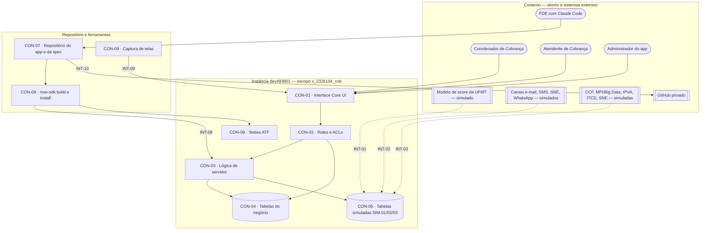

# High-Level Design (TO-BE) — Cobrança MT (piloto 2.6 Cobrança, SEFAZ-MT)

Status: draft
Última atualização: 2026-11-24
Versão: 1.0
Modo: completo
Contexto: greenfield
Fonte: modules.md, requirements/requirements.md, business-rules.md, context-map.md, tech-rules/, docs/designs/speckit-servicenow-v0.md (Technical Plan, decisões A1–A10), outputs/explore/especificacao-tecnica.md

<!-- id: hld-summary -->

## Resumo executivo

O Cobrança MT é um app escopado (`x_2326104_cob`) que roda dentro de uma instância ServiceNow (`dev493801`). Coordenador, atendente e administrador usam a interface clássica da plataforma (Core UI): formulários, listas e relatórios. Todas as regras de negócio, os controles de acesso e os testes automáticos (ATF, o framework de testes da plataforma) moram na própria instância, em três peças do escopo: as tabelas do negócio, as tabelas que simulam os sistemas externos (score da UFMT, canais de envio, fontes de débito) e a lógica de servidor. O código-fonte do app, a especificação e o backlog ficam num repositório GitHub privado, e o app chega à instância por um comando só (`npm run reinstall`). A decisão que condiciona o resto é **configurar antes de customizar** (ADR-01): tabela, formulário, lista, relatório, ACL (regra de acesso da plataforma) e UI Policy saem do gerador; script entra só nas regras do fio condutor (versão imutável do critério, grupo de controle, fallback sem score, dossiê e carteira do atendente).

Integração real com sistemas externos não existe no v0: cada integração do plano é uma tabela do app com dado fictício e rótulo «Simulado» (ADR-09).

---

<!-- id: hld-containers -->

## Contexto e containers

Nível 1 (contexto): três papéis de negócio usam o app pelo navegador; os sistemas externos do plano (UFMT, canais, fontes de débito, sinalizações coercitivas, pipeline CCF/Oracle) aparecem como simulados dentro da instância; o FDE (engenheiro da EloGroup) opera o Claude Code, que lê o repositório e instala na instância. Nível 2 (containers): as peças que rodam e são implantadas separadamente.



### Inventário de containers

| ID | Nome | Responsabilidade | Tecnologia |
|----|------|------------------|------------|
| CON-01 | Interface Core UI | Mostra as 33 telas (TEL-001 a TEL-033) como formulário, lista ou relatório, com menu «Cobrança MT», seções, related lists, activity stream e UI Actions | Core UI clássica (UI16): `Form()`, `List()`, `sys_report`, UI Action e UI Policy em Fluent (architecture.mdc) |
| CON-02 | Roles e ACLs | Decide quem lê, grava, cria e apaga cada tabela e campo, inclusive o filtro «atendente vê só a própria carteira» | Roles `x_2326104_cob.coordenador`, `.atendente`, `.admin`; ACL de registro e de campo em Fluent (security.mdc) |
| CON-03 | Lógica de servidor | Aplica as regras do fio condutor e as automações: versão imutável, publicação de ciclo com sorteio, fallback sem score, consolidação, régua, distribuição, origem da regularização, trilha de exportação | Business Rules, Script Includes e Flow em Glide server-side, scripts em `app/src/server/` (conventions.mdc) |
| CON-04 | Tabelas do negócio | Guarda contribuintes, débitos, critérios, ciclos, carteira segmentada, réguas, comunicações, casos, interações, regularizações, metas e trilha | 17 tabelas `x_2326104_cob_*` com journal e audit nas tabelas de form (architecture.mdc) |
| CON-05 | Tabelas simuladas SIM-01/02/03 | Fazem o papel do score da UFMT, dos canais de envio e das fontes de débito, com rótulo «Simulado» e interruptor de falha | 4 tabelas: `score_sim`, `envio_sim`, `canal_sim`, `debito_stg` (architecture.mdc) |
| CON-06 | Testes ATF | Provam cada regra do fio condutor com caso positivo e negativo; a suíte `cob-regressao` roda a cada reinstalação | `Test()` / `TestSuite()` em Fluent; servidor por `now-sdk cicd test run`, formulário pelo Client Test Runner (test-strategy.mdc) |
| CON-07 | Repositório do app e da spec | Guarda a fonte da verdade: app Fluent em `app/`, spec em `outputs/spec/`, prints e backlog em issues | GitHub privado `arthurleardini/speckit-servicenow` (deploy-and-build.mdc) |
| CON-08 | now-sdk build e install | Transforma o Fluent em metadados e instala na instância; refaz tudo do zero de forma idempotente | `@servicenow/sdk` 4.14.3 via `npm run reinstall` (build `--frozenKeys`, install, contagem, suíte ATF) (deploy-and-build.mdc) |
| CON-09 | Captura de telas | Entra como admin, assume o usuário demo do papel de cada tela e fotografa em 1440×900 | Playwright + Chromium (`sn-capture`), credencial em `.env.instancia` fora do git |

---

<!-- id: hld-decomposition -->

## Decomposição por módulo

| Módulo | Container | Papel no módulo |
|--------|-----------|-----------------|
| MOD-F1 | CON-04 | Contribuinte, débito, parcelamento, sincronização e rejeição |
| MOD-F1 | CON-05 | Staging das 5 fontes de débito (SIM-03) com falha simulada |
| MOD-F1 | CON-03 | Consolidação, vínculo por documento, rejeição de documento inválido, alerta de parcelamento em risco |
| MOD-F1 | CON-01 | TEL-001 a TEL-006 e TEL-032 |
| MOD-F2 | CON-04 | Critério versionado, ciclo e carteira segmentada |
| MOD-F2 | CON-03 | Bloqueio de edição da versão publicada, criação de nova versão, prévia e publicação do ciclo com sorteio do grupo de controle (fio condutor 1 e 2) |
| MOD-F2 | CON-01 | TEL-007 a TEL-010 |
| MOD-F3 | CON-05 | Score simulado da UFMT (SIM-01) com fração sem score |
| MOD-F3 | CON-03 | Fallback sem score na segmentação (fio condutor 3) |
| MOD-F3 | CON-01 | TEL-011 e TEL-012 |
| MOD-F4 | CON-04 | Régua, etapa, comunicação, consentimento e regularização |
| MOD-F4 | CON-05 | Canais e retornos de envio simulados (SIM-02) |
| MOD-F4 | CON-03 | Disparo e escalonamento automáticos, opt-in, fallback de canal, marcação de origem |
| MOD-F4 | CON-01 | TEL-013 a TEL-020 |
| MOD-F5 | CON-04 | Caso e interação |
| MOD-F5 | CON-02 | ACL de linha «atendente vê só a própria carteira» (fio condutor 5) |
| MOD-F5 | CON-03 | Distribuição, prioridade da fila, encerramento por regularização |
| MOD-F5 | CON-01 | TEL-021 a TEL-025; dossiê (TEL-024) como form com related lists (fio condutor 4) |
| MOD-F6 | CON-04 | Meta de KPI; os indicadores leem ciclo, segmentação e regularização |
| MOD-F6 | CON-03 | Cálculo do efeito incremental e do estágio do funil |
| MOD-F6 | CON-01 | TEL-026 a TEL-031 (reports simples e list de efeito incremental) |
| MOD-T | CON-04 | Trilha de exportação |
| MOD-T | CON-03 | Registro de cada exportação na trilha |
| MOD-T | CON-02 | Mesmo filtro de carteira na busca, no relatório e na exportação |
| MOD-T | CON-01 | TEL-033 e busca/filtro padrão das listas |

---

<!-- id: hld-integrations -->

## Integrações externas

Nenhuma chamada sai da instância no v0. As linhas INT-01 a INT-06 descrevem como cada sistema externo do plano é simulado; INT-07 a INT-10 são as ligações reais entre o repositório, as ferramentas e a instância.

| ID | Sistema externo | Container | Direção | Estilo | Protocolo | Falha |
|----|-----------------|-----------|---------|--------|-----------|-------|
| INT-01 | Modelo de score da UFMT | CON-05, CON-03 | entrada | assíncrono | Tabela simulada `score_sim` (SIM-01); contrato real por API ou arquivo em aberto (GAP-008) | Score ausente ou inválido põe o contribuinte em fallback «sem score» (RN-NOVO-F3-002); a qualificação não para |
| INT-02 | Canais e-mail, SMS, SNE, WhatsApp | CON-05, CON-03 | saída | assíncrono | Tabelas simuladas `envio_sim` e `canal_sim` (SIM-02) | Retorno «falha» marca a comunicação para reenvio e tenta o próximo canal da ordem SNE → e-mail → SMS (RN-NOVO-F4-004, RN-NOVO-F4-005) |
| INT-03 | CCF, MPI/Big Data, IPVA, ITCD, SNE | CON-05, CON-03 | entrada | assíncrono | Staging `debito_stg` (SIM-03), lido pela consolidação a cada ciclo | Fonte com falha fica registrada na sincronização e as demais seguem (RN-NOVO-F1-005) |
| INT-04 | Sinalizações coercitivas (CCF/SNE/SUCOM) | CON-04 | entrada | assíncrono | Campo `sinal_coercitivo` no caso, preenchido pelo seed (GAP-016) | Sem sinalização, o dossiê mostra o campo desmarcado; nenhuma ação coercitiva é executada (RN-NOVO-F5-004) |
| INT-05 | CCF/Oracle | CON-04 | entrada | assíncrono | Não integrado no v0: os reports leem as tabelas do app (GAP-011) | Sem efeito no v0 |
| INT-06 | App escopado `x_2326104_cob` | CON-03, CON-04 | bidirecional | síncrono | Escopo próprio, sem acesso cross-scope declarado no v0 | Acesso de outro escopo é negado pela plataforma (SEC-007) |
| INT-07 | ServiceNow PDI `dev493801` (release Brazil) | CON-08 | saída | síncrono | `now-sdk install` autenticado pelo alias `dev493801` | Install falho registra `falha-install` no sync-log e mantém a versão anterior; instância reclamada volta com `npm run reinstall` |
| INT-08 | Instalação do app pelo now-sdk | CON-08, CON-03 | saída | síncrono | `now-sdk build --frozenKeys` + `now-sdk install` | Prefixo de escopo diferente do `now.config.json` interrompe antes de instalar |
| INT-09 | Captura das telas na instância | CON-09, CON-01 | saída | síncrono | HTTPS com login admin e impersonate do usuário demo | Rota que não carrega encerra a captura com código diferente de zero |
| INT-10 | GitHub privado | CON-07 | saída | síncrono | `gh` + API REST (issues, sub-issues, permalink de PNG) | Publicador para com erro se faltar print obrigatório; reexecução não duplica issues |

---

<!-- id: hld-flows -->

## Fluxos arquiteturais

| ID | Fluxo | Caminho | Nota |
|----|-------|---------|------|
| FLA-01 | FLX-002 | CON-01 → CON-02 → CON-03 → CON-04 | Publicar versão do critério e criar nova versão (fio condutor 1): a Business Rule recusa edição de versão publicada antes de gravar |
| FLA-02 | FLX-002 | CON-01 → CON-03 → CON-05 → CON-04 | Gerar prévia e publicar o ciclo: segmenta com o critério publicado, lê o score simulado (fallback sem score), sorteia o grupo de controle com semente gravada (fio condutor 2 e 3) |
| FLA-03 | FLX-001 | CON-05 → INT-03 → CON-03 → CON-04 | Consolidação a cada ciclo: lê o staging, rejeita documento inválido, vincula ao contribuinte, registra a sincronização por fonte |
| FLA-04 | FLX-004 | CON-03 → CON-05 → INT-02 → CON-04 | Régua: disparo automático por etapa, retorno simulado do canal, fallback de canal, encerramento por regularização |
| FLA-05 | FLX-005 | CON-01 → CON-02 → CON-04 | Atendente abre a fila e o dossiê: a ACL de linha devolve só os casos e contribuintes dele (fio condutor 4 e 5) |
| FLA-06 | — | CON-07 → CON-08 → INT-07 → CON-06 | Reinstalação: build, install, contagem de registros contra `_contagem.json` e suíte ATF `cob-regressao` |

---

<!-- id: hld-deployment -->

## Topologia de implantação

| Ambiente | Topologia | Observação |
|----------|-----------|------------|
| Desenvolvimento | Uma PDI (`dev493801`, release Brazil) com o escopo `x_2326104_cob`; repositório local do FDE com `app/` | É o único ambiente do v0; a instância é reclamada após 10 dias sem login e volta com `npm run reinstall` |
| Homologação | Não existe no v0; ensaio numa instância zerada ou numa segunda PDI com o mesmo prefixo | Mesmo comando de reinstalação, mesma semente do seed |
| Produção | Fora do v0; na SEFAZ-MT o caminho é dev → test → prod pelo Application Repository (RN-SN-164, RN-SN-167) | Integrações reais substituem as tabelas SIM- |

---

<!-- id: hld-nfr-tactics -->

## Táticas por RNF

| RNF | Métrica | Tática ou risco aceito | Containers | Justificativa |
|-----|---------|------------------------|------------|---------------|
| RNF-SEGURANCA-001 | 100% dos registros de pessoa com `ficticio = true` e documento listado em `_documentos.json`; `check_sensivel.py` com score < 40 nos `.md` | Seed gerado com semente fixa e DV válido; reinstalação confere os documentos antes de instalar | CON-04, CON-05, CON-08 | Sigilo fiscal (CTN art. 198) e LGPD (RN-NOVO-T-002) |
| RNF-SEGURANCA-002 | 0 registros de outro atendente visíveis ao atendente em list, form, report, related list e exportação | ACL de linha por operação nas tabelas de carteira e Data Filter com Deny; teste ATF negativo com dois atendentes demo | CON-02, CON-06 | Fio condutor 5 (RN-NOVO-F5-007) |
| RNF-CONFIABILIDADE-001 | 2 reinstalações seguidas dão a mesma contagem de registros por tabela | `$id` fixos (`keys.ts`), `installMethod: 'demo'`, build `--frozenKeys` | CON-07, CON-08 | Instância de desenvolvedor é volátil (A9, A1) |
| RNF-CONFIABILIDADE-002 | Falha em 1 das 5 fontes não reduz a 0 a consolidação das outras 4 | Consolidação processa fonte a fonte e registra a falha na sincronização | CON-03, CON-05 | RN-NOVO-F1-005 |
| RNF-DESEMPENHO-001 | Telas de lista e form carregam em até 3 s com até 300 registros por tabela | Configuração OOTB, GlideAggregate para contagens, sem consulta em laço, laço de Flow ≤ 1.000 iterações (RN-SN-20, RN-SN-22, RN-SN-154) | CON-01, CON-03 | Volume do seed no Plan |
| RNF-USABILIDADE-001 | 33 de 33 telas com print na visão do papel | Core UI clássica gerada pelo `sn-scaffold`; captura por impersonate | CON-01, CON-09 | A2 e A10 |
| RNF-MANUTENIBILIDADE-001 | 0 objetos do app criados à mão na instância fora do git | Fonte só em `app/src/fluent` e `app/src/server`; instalação só por `npm run reinstall` | CON-07, CON-08 | RN-SN-164 |
| RNF-SEGURANCA-003 | 100% das ações relevantes (publicar critério, reenviar, registrar interação, encerrar caso, exportar) com autor e hora registrados | `audit` e journal nas tabelas com form; Business Rule grava a trilha de exportação; registros de interação sem exclusão pelo atendente (ACL delete) | CON-02, CON-03 | RN-NOVO-F5-005, RN-NOVO-T-001 |

---

<!-- id: hld-security -->

## Segurança de alto nível

| ID | Fronteira | Containers | Controles | Ameaça AS-IS |
|----|-----------|------------|-----------|--------------|
| TRB-01 | Usuário no navegador → instância | CON-01, CON-02 | Login da plataforma; roles do app; ACL por tabela, campo e operação; UI Policy só como UX (SEC-001 a SEC-005) | — |
| TRB-02 | Atendente → carteira de outro atendente | CON-02, CON-03 | ACL de linha e Data Filter com Deny; scripts de usuário com GlideRecordSecure (SEC-002, SEC-004) | — |
| TRB-03 | Outro escopo ou API → escopo `x_2326104_cob` | CON-02, CON-03 | Sem `CrossScopePrivilege`; Script Include `package_private`; sem `allowWebServiceAccess` (SEC-006, SEC-007) | — |
| TRB-04 | Repositório e ferramentas → instância | CON-07, CON-08, CON-09 | Credencial só em `.env.instancia` (chmod 600, fora do git, negado ao agente); conferência do prefixo antes do install (SEC-013, SEC-014) | — |
| TRB-05 | Repositório → GitHub e issues | CON-07 | Só dado fictício; `check_sensivel.py` antes de publicar (SEC-012) | — |

---

<!-- id: hld-adr -->

## Decisões de arquitetura (ADR)

| ID | Decisão | Contexto | Alternativas rejeitadas | Consequências | Origem |
|----|---------|----------|-------------------------|---------------|--------|
| ADR-01 | Configurar antes de customizar: tabela, form, list, report, menu, role, ACL, UI Policy e Data Policy saem do gerador ou de configuração OOTB; script (Business Rule, Script Include, Flow) só para as regras do fio condutor e automações sem recurso nativo | Plataforma low-code com recursos nativos para quase todas as telas; app precisa ser regerável e atualizável (RN-SN-13, RN-SN-60, RN-SN-151) | Customizar a UI (UI Builder, Service Portal, páginas Jelly) — custo de manutenção e fora do escopo do v0 | Dossiê e painel de KPIs ficam como form e reports simples (GAP-012, GAP-013); cada script novo precisa de teste ATF positivo e negativo | architecture.mdc |
| ADR-02 | Fork adaptável do harness Elo em dois modos (template e travado) (A1) | O kit precisa mudar hooks, rules e skills para ServiceNow | Camada sobre o kit sem fork (Alternativa A) | Manutenção própria do fork; comparação manual com a tag base | — |
| ADR-03 | A instância é o protótipo: sem HTML, prints tirados da instância (A2) | Protótipo HTML mostra tela que não vai existir na Core UI | Protótipo HTML com um ou dois geradores (Alternativas B e C) | Telas fora do padrão form/list viram GAP; o Explore exige install antes do fecho | architecture.mdc |
| ADR-04 | Um repositório só com kit, spec, app Fluent e issues (A3) | Demo precisa mostrar a cadeia num lugar | Repositórios separados (Alternativa G) | Extrair o kit fica para M6 | deploy-and-build.mdc |
| ADR-05 | Backlog em issues e sub-issues do GitHub, idempotente por `id-map.json` e marcador `logical-id`, PNG por permalink (A4) | ADO exige organização, PAT e template; publicador nunca rodou contra ADO real | `gh --attach` (D), Azure DevOps (E), Agile 2.0 na instância (F) | PNG commitado no repositório; API de sub-issue exige `id` numérico | — |
| ADR-06 | Skills novas `sn-*` como extensão; etapas `spec-*` alteradas no lugar (A5) | Zona imutável do harness | Duplicar todas as skills | Atualização do template não sobrescreve as extensões | — |
| ADR-07 | Tipo ServiceNow em campo próprio `Task.snArtifact` no schema `tasks/v5.4`, sem mudar `Task.type` (A6) | Validadores existentes leem `Task.type` | Novo enum de tipo | Leitores antigos seguem funcionando | — |
| ADR-08 | IDs no formato nativo do kit: `RF-MOD-F<n>-<nnn>`, `RF-MOD-T-<nnn>`, `CT-MOD-F<n>-<nnn>`; família nova só `SIM-<nn>`; `$id` Fluent usa o ID da spec (A7) | Um ID precisa ligar spec, tela, issue, código e teste | IDs próprios do plano (`F2/RF-03`) | De-para obrigatório (`inputs/de-para-ids.md`) | conventions.mdc |
| ADR-09 | Integrações externas simuladas como tabelas do app com seed, rótulo «Simulado» e interruptor de falha; contratos de API opcionais no v0 (A8) | Score UFMT, canais e fontes não têm contrato nem acesso | Mock externo ou integração real | Troca para integração real exige spoke por sistema e alias de conexão (RN-SN-162) | architecture.mdc |
| ADR-10 | Seed fictício por `Record()` com `installMethod: 'demo'`, CPF/CNPJ com DV válido de semente fixa, `ficticio = true`, usuários demo sem senha (A9) | Nenhum dado real pode entrar; seed precisa voltar idêntico a cada reinstalação | Build Agent da plataforma (Alternativa I) | Volume limitado a 300 por tabela; lista `_documentos.json` conferida no gate | deploy-and-build.mdc |
| ADR-11 | Prints por script na visão do papel: Playwright entra como admin e faz impersonate do usuário demo da tela, 1440×900 (A10) | Print precisa mostrar o que o papel vê | Captura manual | Credencial admin fica em `.env.instancia`; impersonate restrito a usuários demo (SEC-015) | test-strategy.mdc |

---

<!-- id: hld-risks -->

## Riscos técnicos e spikes

| ID | Risco | Impacto | Spike sugerido | Alvo |
|----|-------|---------|----------------|------|
| RSK-01 | ATF de formulário pode não rodar pela linha de comando sem navegador (Q2 do design) | Fio condutor sem recibo de ATF de form; isenção registrada por story | Rodar `now-sdk cicd test run` com um teste de form e com o Client Test Runner aberto; registrar o desfecho | CON-06 |
| RSK-02 | Script de ACL de carteira roda por registro em lista e report e pode ficar lento (RN-SN-142) | Lista e report acima de 3 s | Medir TEL-023 e TEL-031 com 300 casos e dois atendentes; trocar por condição ou Data Filter se passar de 3 s | CON-02 |
| RSK-03 | Report da Core UI pode ignorar ACL de linha em agregações | Atendente vê totais de outros | ATF negativo em TEL-031 com atendente demo; conferir contagem | CON-01 |
| RSK-04 | Instância reclamada na véspera da demo | Demo sem app | Reinstalação completa na véspera; segunda PDI com o mesmo prefixo | INT-07 |
| RSK-05 | Contrato real do score e dos canais muda o desenho das tabelas SIM- | Retrabalho no MOD-F3 e MOD-F4 | Revisar a tabela simulada quando GAP-008 e GAP-009 fecharem | MOD-F3 |

---

<!-- id: open-questions -->

## Questões em aberto

| # | Pergunta | Evidência/contexto (RNF, INT-NN, arquivo:linha) | Bloqueia próxima fase? |
|---|----------|--------------------------------------------------|-------------------------|
| 1 | O ATF de formulário roda pela linha de comando? | RSK-01; design Q2 | não — isenção por story prevista |
| 2 | Contrato técnico do score da UFMT | INT-01; GAP-008 | não no v0 |
| 3 | Contrato do WhatsApp | INT-02; GAP-009 | não no v0 |
| 4 | Fonte do pipeline em tempo real e das sinalizações coercitivas | INT-04, INT-05; GAP-011, GAP-016 | não no v0 |
| 5 | FLA-01 a FLA-05 ligados aos FLX do `flow-map.md`; FLA-06 (reinstalação) não tem fluxo de negócio | FLA-01 a FLA-06 | não |

---

<!-- id: hld-coverage -->

## Cobertura

```
GATES:
  MODULES_MAPPED: OK
  EXTERNAL_SYSTEMS_ADDRESSED: OK
  NFR_TACTICS_MAPPED: N/A (fonte ausente)
  CONTAINERS_CONSISTENT: OK
  ADR_PER_DECISION: OK
  ASIS_DELTA_PRESENT: N/A (greenfield)
  COMPACT_MODE_DECLARED: N/A (modo completo)
MÉTRICAS:
  modo=completo contexto=greenfield
  containers=9 integrações=10 táticas=7 ADRs=11 riscos=5
  % módulos mapeados: 100.0% (N/A justificado: nenhum)
  containers órfãos: nenhum
  RNF com risco aceito: nenhum
  integrações assíncronas: INT-01, INT-02, INT-03, INT-04, INT-05
  spikes sugeridos: 5
RESULTADO: OK (0 erro(s), 1 aviso(s))
```

Validação refeita com o `requirements/requirements.md` presente: as 8 RNF de negócio (RNF-SEGURANCA-001/002/003, RNF-CONFIABILIDADE-001/002, RNF-DESEMPENHO-001, RNF-USABILIDADE-001, RNF-MANUTENIBILIDADE-001) têm tática.
